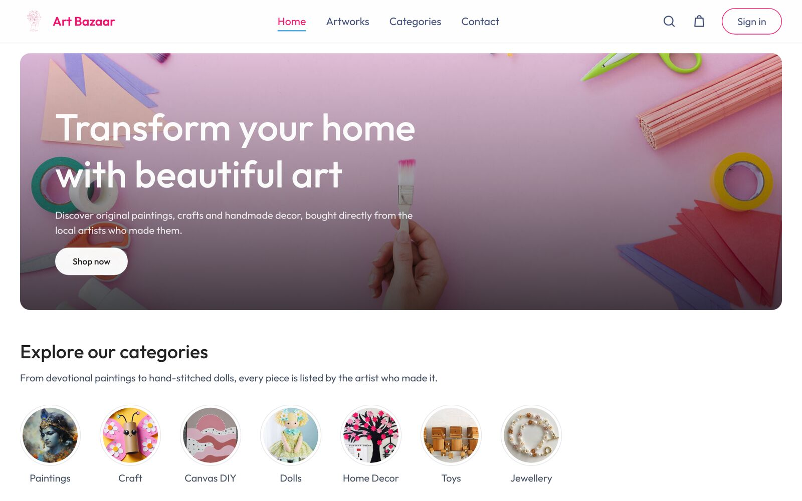
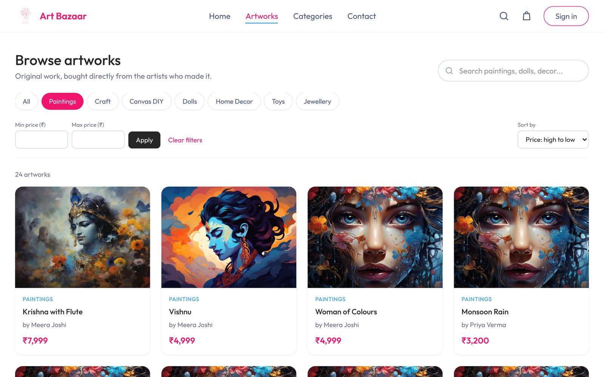
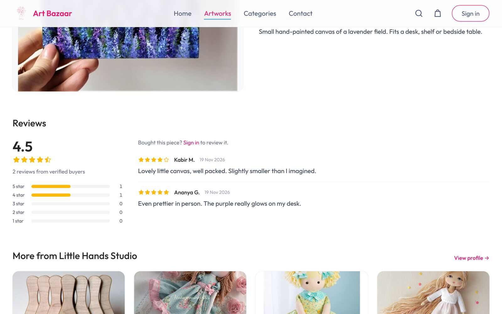
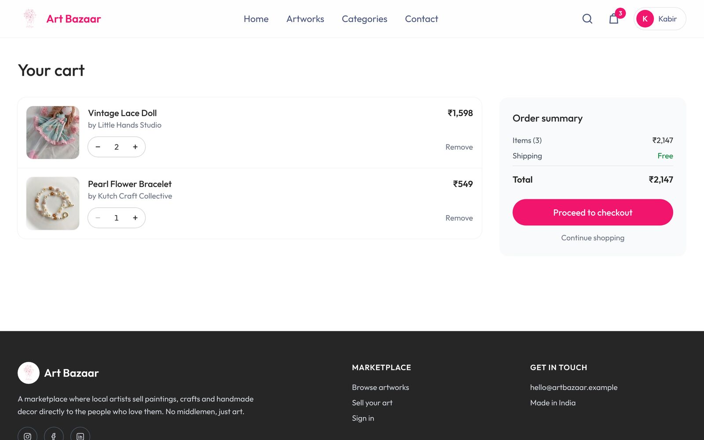
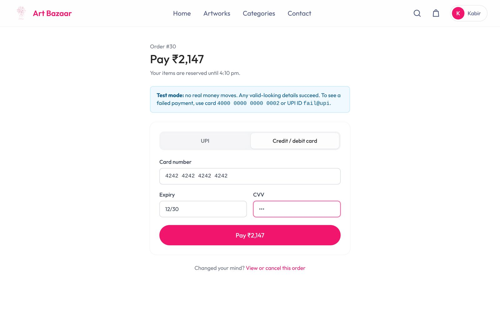
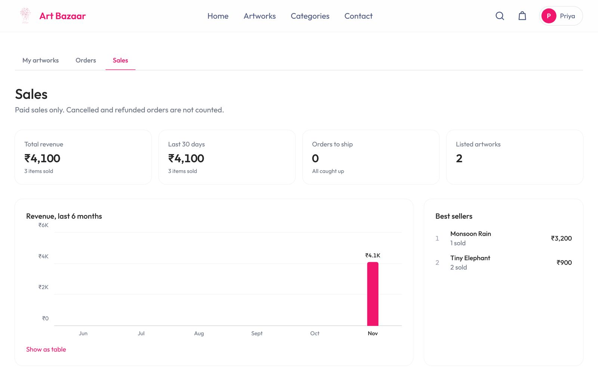
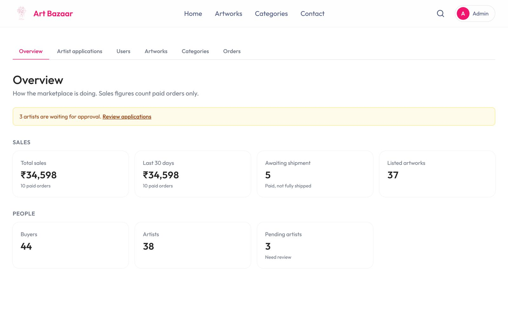
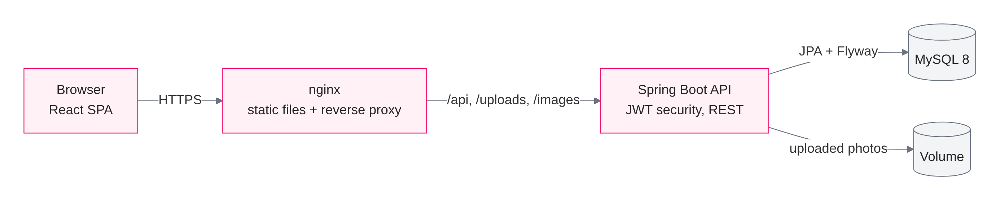

# Art Bazaar

[](https://github.com/poorvishuklaa/Art-Bazar/actions/workflows/ci.yml)

A marketplace where local artists register, list their artworks and sell directly to buyers.

**Live demo:** https://art-bazaar.up.railway.app

**Stack:** Java 21 · Spring Boot 4 · Spring Security (JWT + role-based access) · Spring Data JPA · MySQL 8 · Flyway · React 18 · Vite · Tailwind CSS · TanStack Query · Docker · Railway



| Browse with filters | Verified-purchase reviews |
|---|---|
|  |  |
| **Cart** | **Simulated payment** |
|  |  |
| **Artist sales dashboard** | **Admin overview** |
|  |  |

## What it does

| Role | Features |
|------|----------|
| **Buyer** | Search and filter the catalog, artist profiles, cart, checkout with simulated UPI/card payment, order tracking and cancellation, reviews of purchased artworks |
| **Artist** | Everything a buyer can do, plus: list artworks with photo upload, hide/edit/delete listings, ship their part of each order, sales dashboard. New artists need admin approval before listing |
| **Admin** | Approve artists, disable accounts, take down listings, manage categories, remove reviews, see all orders and platform totals |

## Architecture



The browser only ever talks to one origin: nginx serves the React build and forwards API calls to Spring Boot over the private network. That keeps the refresh-token cookie `SameSite=Strict` and removes the need for cross-origin cookies.

**Backend layout** (`backend/src/main/java/com/artbazaar`)

```
config/      security rules, CORS, demo-data seeder, admin bootstrap
security/    JWT service + filter, login rate limiter, current-user loader
controller/  REST endpoints (thin)
service/     business rules and transactions
repository/  Spring Data JPA repositories, Specifications, JPQL aggregates
entity/      JPA entities (schema owned by Flyway; Hibernate only validates it)
dto/         request/response records
storage/     image storage (local disk; one interface to swap for S3/Cloudinary)
```

## Engineering highlights

- **Authentication done properly.** Short-lived JWT access tokens are kept in memory only. Refresh tokens are random, rotate on every use, are stored only as SHA-256 hashes, and live in an `HttpOnly` cookie. Reusing an old refresh token signs that user out everywhere. Each token records *why* it was revoked, so a 10-second grace period lets two tabs refresh at once without logging anyone out, while logout, password changes and disabled accounts take effect immediately.
- **Role-based access** at two levels: URL rules in `SecurityConfig` (`/api/admin/**`, `/api/artist/**`), plus method-level `@PreAuthorize` for approved artists. Every request reloads the user, so disabling an account or approving an artist takes effect at once.
- **No overselling.** Checkout locks the artworks with `SELECT … FOR UPDATE` in a fixed order (no deadlocks), and stock is reserved when the order is placed. A test fires four checkouts at the last piece at the same moment, and exactly one wins. Unpaid orders release their stock after 30 minutes.
- **Multi-artist orders.** Each order line keeps its artist and a snapshot of the title and price. Every artist ships their own part, and the overall order status is derived from all of them.
- **Verified reviews.** Only buyers with a paid, uncancelled order line for an artwork can review it. Rating averages for a page of cards come from one grouped query, not one query per card.
- **Hardening:** uploads are checked by their magic bytes, not their file name; LIKE wildcards in searches are escaped; failed logins are throttled per email and IP (429 with `Retry-After`); all errors return the same JSON shape with field-level validation messages; card details are never stored.
- **Schema as code.** Five Flyway migrations, with Hibernate set to `validate`, so entities and schema can't drift apart.

## Running locally

### Everything in Docker

```bash
cp .env.example .env          # set JWT_SECRET (openssl rand -base64 48) and the passwords
docker compose up --build
```

Web app http://localhost:3000 · API http://localhost:8080 · Swagger UI http://localhost:8080/swagger-ui.html

### Dev mode with hot reload

```bash
docker compose up -d mysql
```

```bash
cd backend && ADMIN_EMAIL=admin@example.com ADMIN_PASSWORD=ChangeMe123 mvn spring-boot:run
```

```bash
cd frontend && npm install && npm run dev      # http://localhost:5173, proxies /api to :8080
```

On first start, Flyway creates the schema, and the seeder adds 3 demo artists with 18 artworks.

### Try it

- **Payment test data:** any valid UPI ID (`name@bank`) or Luhn-valid card (for example `4242 4242 4242 4242`, any future expiry, any 3-digit CVV) succeeds. Card `4000 0000 0000 0002` or UPI ID `fail@upi` is declined.
- **To see the artist side:** register as an artist, approve yourself from the admin account (Admin → Artist applications), then add artworks.

## Configuration

**Backend**

| Variable | Default |
|----------|---------|
| `DB_URL` · `DB_USERNAME` · `DB_PASSWORD` | local MySQL `artbazaar` / `artbazaar` |
| `JWT_SECRET` | development key, **always set in production** |
| `JWT_ACCESS_TTL` · `JWT_REFRESH_TTL` | `15m` · `7d` |
| `REFRESH_COOKIE_SECURE` | `false`; set `true` behind HTTPS |
| `ADMIN_EMAIL` · `ADMIN_PASSWORD` · `ADMIN_NAME` | unset, so no admin is created |
| `CORS_ALLOWED_ORIGINS` | `http://localhost:5173` |
| `UPLOAD_DIR` | `./uploads` |
| `ORDER_PAYMENT_WINDOW` | `30m` |
| `SEED_DEMO_DATA` | `true` (only acts when the catalog is empty) |
| `PORT` | `8080` |

**Frontend container (nginx)**

| Variable | Default |
|----------|---------|
| `PORT` | `80` |
| `BACKEND_URL` | `http://backend:8080` |
| `NGINX_RESOLVER` | `127.0.0.11` (Docker DNS); `[fd12::10]` on Railway |

## API overview

Interactive documentation for every endpoint is at `/swagger-ui.html`. The main groups:

| Area | Endpoints | Access |
|------|-----------|--------|
| Auth | `POST /api/auth/register · login · refresh · logout`, `GET /api/auth/me` | public / signed in |
| Account | `GET·PUT /api/account`, `POST /api/account/password` | signed in |
| Catalog | `GET /api/artworks?q&category&minPrice&maxPrice&artistId&sort&page`, `GET /api/artworks/{id}`, `GET /api/artists/{id}`, `GET /api/categories` | public |
| Reviews | `GET /api/artworks/{id}/reviews`, `GET·PUT·DELETE /api/artworks/{id}/reviews/me` | public / buyers who purchased |
| Cart & orders | `/api/cart`, `/api/cart/items/{artworkId}`, `POST /api/orders`, `POST /api/orders/{id}/pay · cancel`, `GET /api/orders` | buyers and artists |
| Artist | `/api/artist/artworks` (multipart CRUD + status), `/api/artist/orders`, `PATCH /api/artist/orders/{id}/fulfilment`, `/api/artist/sales/summary` | artists (changes need approval) |
| Admin | `/api/admin/stats · users · artworks · categories · orders · artists`, `DELETE /api/admin/reviews/{id}` | admins |

Errors always look like this:

```json
{ "status": 400, "error": "Bad Request", "message": "Validation failed",
  "path": "/api/orders", "fieldErrors": { "pincode": "Enter a valid 6-digit PIN code" } }
```

## Tests

```bash
cd backend && mvn verify      # 54 integration tests on in-memory H2 with the real Flyway migrations
cd frontend && npm run lint && npm run build
```

The backend tests cover authentication and token rotation, access rules for every role, the catalog and uploads, checkout including concurrent buyers, payment declines, cancellation and expiry, multi-artist fulfilment, sales figures, admin moderation, reviews, account changes and login throttling. GitHub Actions runs everything on each push.

## Deployment

The live demo runs on Railway as three services: **MySQL**, **backend** (Dockerfile in `backend/`, health check `/api/health`, a volume at `/app/uploads`) and **frontend** (Dockerfile in `frontend/`, the public domain). The frontend reaches the backend over Railway's private network, so the API has no public address of its own.

## Project structure

```
backend/              Spring Boot API, Flyway migrations, integration tests
frontend/             React app (pages/, components/, api/, hooks/), nginx config template
docs/screenshots/     images used in this README
docker-compose.yml    MySQL + API + web for local runs
.github/workflows/    CI
```
